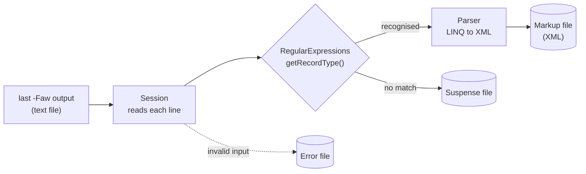

# Last -Faw XML Parser

A C# command-line tool that turns Linux login history into structured XML. It reads the text output of the `last -Faw` command, classifies each line with regular expressions (user sessions, reboots, shutdowns, crashes and run-level changes), writes the recognised records to an XML file, and sets malformed lines aside in a separate "suspense" file for review.

> **Note:** This was a personal project. It is not deployed or used in production anywhere.

**Version 1.0**

---

## Background

On Linux, `last` reads the system's `wtmp` log and lists every login, logout, reboot and shutdown. The flags this tool expects are:

| Flag | Meaning |
|---|---|
| `-F` | Print full login and logout dates and times |
| `-a` | Put the remote hostname in the last column |
| `-w` | Show full user and domain names |

Login history like this is a common starting point for auditing who accessed a server, from where, and for how long. Plain text is awkward to analyse, so this tool converts it into XML that other tools can query.

## Features

- **Record classification.** Each line is matched against regular-expression patterns for six record types:

  | XML element | Matches | Fields captured |
  |---|---|---|
  | `complete` | A finished session with login time, logout time and duration, from a remote host or a local terminal | Username, Terminal, Date, Duration, RemoteTerminal |
  | `incomplete` | A session that is `still logged in` | Username, Terminal, Date, Duration (empty), RemoteTerminal |
  | `system-crash` | A session that ended because the system went `down` | Username, Terminal, Date, Duration |
  | `system-shutdown` | `shutdown system down` records | Date, Duration, Terminal |
  | `reboot` | `reboot system boot` records | Date, Duration, Terminal |
  | `runlevel-change` | `runlevel (to lvl N)` records | Description, Date, Duration, Terminal |

- **Validation of every field.** Patterns check real weekday and month names, days 1–31, hours 00–23, minutes and seconds 00–59, and terminal names such as `pts/3` or `tty1`. A record with an impossible date like `Oct 32` or a time like `18:64:06` doesn't match any pattern.
- **Suspense file.** Lines that don't match any pattern are appended to a suspense file instead of being dropped, so nothing is silently lost.
- **Input check.** The tool confirms the input ends with the `wtmp begins …` trailer that `last` prints, logs an error if it doesn't, and prints the log's start date and the input file's creation time.
- **Error log.** Application errors are appended to an error file.
- **Command-line options.** Arguments are parsed with the CommandLineParser library, which prints usage help when a required option is missing.

## How it works



The code is organised around a few small classes:

- **`Program`** parses the command-line options and stops with exit code 2 if the input file doesn't exist.
- **`InputFile`** wraps the input path, checks for the `wtmp` trailer and reads the log's start date.
- **`Session`** reads the input line by line and sends each record to the parser or the suspense file.
- **`RegularExpressions`** builds the record-type patterns from reusable pieces (weekday, month, time, duration, terminal, host) and classifies lines.
- **`Field`** is an abstract base class. Its subclasses `Username`, `Terminal`, `Date`, `Duration` and `RemoteTerminal` each extract one value from a record, and their class names become the XML element names.
- **`Parser`** creates the XML file if needed and appends one element per record using `System.Xml.Linq`.
- **`ErrorLog`** appends messages to the error file.

Visual Studio class diagrams (`ClassDiagram1–3.cd`) are included in the project.

## Example

Input from `last -Faw`:

```
alice    pts/0        Mon Oct 24 09:15:02 2016 - Mon Oct 24 11:42:10 2016  (02:27)     203.0.113.10
bob      pts/1        Mon Oct 24 13:01:44 2016   still logged in                       host.example.com
reboot   system boot  Thu Oct 27 16:22:10 2016 - Sat Oct 29 20:39:59 2016 (2+04:17)    2.6.32-642.6.2.el6.i686
erin     pts/3        Sat Oct 32 19:19:05 2016   still logged in                       host.example.com

wtmp begins Sat Oct  1 03:05:02 2016
```

Resulting markup file:

```xml
<Sessions>
  <complete>
    <Username>alice</Username>
    <Terminal>pts/0</Terminal>
    <Date>Mon Oct 24 09:15:02 2016</Date>
    <Duration>(02:27)</Duration>
    <RemoteTerminal>203.0.113.10</RemoteTerminal>
  </complete>
  <incomplete>
    <Username>bob</Username>
    <Terminal>pts/1</Terminal>
    <Date>Mon Oct 24 13:01:44 2016</Date>
    <Duration></Duration>
    <RemoteTerminal>host.example.com</RemoteTerminal>
  </incomplete>
  <reboot>
    <Date>Thu Oct 27 16:22:10 2016</Date>
    <Duration>(2+04:17)</Duration>
    <Terminal></Terminal>
  </reboot>
</Sessions>
```

Erin's record goes to the suspense file because `Oct 32` isn't a valid date. The blank line and the `wtmp begins` trailer also land there, since neither is a session record.

## Requirements

- Windows with Visual Studio 2015 or later (the solution was created in Visual Studio 2015)
- .NET Framework 4.5.2. Newer Visual Studio versions no longer ship the 4.5.2 targeting pack and offer to retarget the project to a newer 4.x version, such as 4.8, which is the simplest option.
- NuGet, to restore the [CommandLineParser](https://www.nuget.org/packages/CommandLineParser/1.9.71) 1.9.71 package. The `packages` folder is git-ignored, so it has to be restored before the first build.
- A Linux machine to produce input with `last -Faw`

## Building

1. Clone the repository:

   ```bash
   git clone https://github.com/mchnldyb/last-faw-xml-parser.git
   ```

2. Open `Last/Last.sln` in Visual Studio.
3. Build the solution. Visual Studio restores the NuGet package automatically. From the command line, run `nuget restore Last\Last.sln` first, then `msbuild Last\Last.sln`.

The executable is written to `Last\Last\bin\Debug\Last.exe` (or `bin\Release`).

## Usage

On a Linux machine, save the login history to a file:

```bash
last -Faw > last.txt
```

Then run the parser on Windows:

```
Last.exe -i last.txt -m sessions.xml -s suspense.txt -e errors.txt
```

| Option | Long form | Required | Description |
|---|---|---|---|
| `-i` | `--input` | Yes | The `last -Faw` output to parse |
| `-m` | `--markup` | Yes | XML file for parsed records (created if it doesn't exist) |
| `-s` | `--suspense` | Yes | File for lines that couldn't be parsed |
| `-e` | `--error` | Yes | File for application errors |

The tool prints the log's start date and the input file's creation time, processes the file, then waits for you to press Enter before exiting.

All three output files are appended to, not overwritten. Delete them before re-running on the same input, or you'll get duplicate records.

## Project structure

```
Last/
├── Last.sln                 Visual Studio solution
├── output.xml               Sample markup output from earlier runs
├── suspense.txt             Sample suspense output from earlier runs
├── errorLog.txt             Sample error output
└── Last/
    ├── Program.cs           Entry point
    ├── Options.cs           Command-line option definitions
    ├── Argconstants.cs      Shared file paths from the command line
    ├── InputFile.cs         Input validation and start date
    ├── Session.cs           Line-by-line processing and suspense file
    ├── RegularExpressions.cs  Record-type patterns and classification
    ├── Parser.cs            XML output with LINQ to XML
    ├── Field.cs             Abstract base class for extracted fields
    ├── Username.cs, Terminal.cs, Date.cs, Duration.cs, RemoteTerminal.cs
    ├── ErrorLog.cs          Error file writer
    ├── XMLParse.cs          Empty subclass of Parser (unused)
    ├── ClassDiagram1-3.cd   Visual Studio class diagrams
    ├── App.config, packages.config, Last.csproj
    └── Properties/AssemblyInfo.cs
```

## Known issues

- **An invalid input file is still processed.** When the `wtmp` trailer is missing, the tool writes an error but carries on parsing, and its console message says "Is valid". The error message is also missing a space before the file name.
- **The whole XML file is rewritten for every record.** `Parser` loads and saves the markup file once per line, so large logs are slow to process. Building the document in memory and saving once at the end would fix this.
- **It waits for Enter at the end.** The final `Console.ReadLine()` blocks scripts and scheduled tasks.
- **Run-level descriptions land outside their element.** A misplaced parenthesis leaves `<Description>` empty and puts the run-level text (e.g. `(to lvl 3)`) loose inside `<runlevel-change>`.
- **Local logins get the duration as their host.** For a session with no remote host, `RemoteTerminal` picks up the last value on the line, which is the duration, e.g. `(00:30)`.
- **Narrow patterns.** Only years 2000–2099 and terminal names like `pts/N` or `ttyN` are recognised. Sessions on terminals such as `:0` or `console`, and formats from other versions of `last`, go to the suspense file.


> **Note:**  .NET Framework 4.5.2 reached end of support in April 2022, and CommandLineParser 1.9 has since been replaced by a 2.x release with a different API. 

